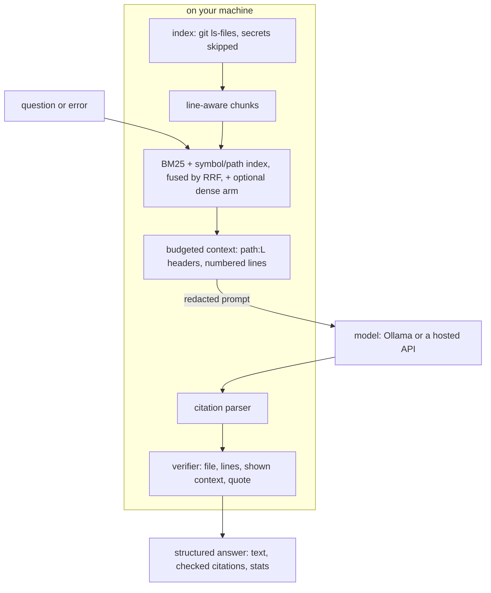

# VIBETTER

**Questions about AI-written code, answered from your repo, with every file:line citation checked.**

VIBETTER is an MCP server for Claude Code, Cursor, Claude Desktop and Windsurf. It splits your
repo into line-numbered chunks, retrieves the ones a question needs, and asks the model you
choose to cite `path:L12-L20`. Then it checks each citation without a second model call: the
file must be indexed, the lines must exist, and the lines must be in the context the model was
shown. It also explains the latest change, diagnoses errors, and draws a dependency graph from
static imports.

[](https://github.com/neerajbhargav/vibetter/actions/workflows/ci.yml)
[](LICENSE)
[](https://www.python.org/downloads/)


*A real, uncut recording made with [VHS](https://github.com/charmbracelet/vhs) from [docs/demo.tape](docs/demo.tape): `vibetter ask` on ky v2.2.0, answered by qwen2.5-coder:7b in local Ollama on an Apple M4 Pro, with the model already loaded. Two citations check out. The model also cited `L1415` in a 46-line file, and VIBETTER flags it with the reason. Answers differ between runs; this take was kept because it shows a failed check.*

## The problem

AI coding tools ship code faster than you can read it. You accept a diff, the tests pass, and
six weeks later nobody on the team can explain why that file exists.

VIBETTER runs inside the same IDE session, reads the same repo, and gives the model the source
itself rather than a summary. Ask it what changed and why, then check the cited lines.

## Results

The public eval asks 66 questions about three pinned repos (click 8.5.0, requests v2.34.2,
ky v2.2.0), each with gold line spans. Caveats first: the labels come from one pass with no
held-out set; the symbol-matching rule was changed after this set exposed a problem; and the
answer eval uses one small local model, whose memory of these popular repos can help its
key-term recall. Method, all arms and raw results: [eval/README.md](eval/README.md).

| Metric | v1 (`main`) | v2 [95% CI] | n | Setup | Reproduce |
|---|---|---|---|---|---|
| Share of gold lines in a 24k-char context | 0.000 | 0.542 [0.429, 0.657] | 66 questions | retrieval only, no LLM, commit `c4eb002` | `uv run python -m eval.run --retrieval` |
| Share of gold lines in a 60k-char context | 0.000 | 0.798 [0.706, 0.884] | 66 questions | same | same |
| Citations that name real lines | 0.653 | 0.922 [0.884, 0.955] | 198 answers per arm | qwen2.5-coder:7b Q4_K_M, Ollama 0.40.8, 3 runs, commit `47bcbf8` | `uv run python -m eval.run --llm` |
| Citations to lines the model was shown | 0.000 | 0.837 [0.778, 0.890] | 198 answers per arm | same | same |
| Answers that cite a gold span | 0.000 | 0.343 [0.258, 0.434] | 198 answers per arm | same | same |

Measured 2026-10-23. Answer metrics are means of 3 runs; v1's intervals are in the eval README.
v1's context fills up with each repo's changelog or readme, so it holds no gold line. With
`strict=true`, every remaining citation names shown lines; the gold-hit rate stays 0.343 and 9%
of answers lose all their citations. CI re-runs the retrieval eval on every push and fails if
v2's recall drops more than one point below the committed baseline.

## Quickstart

Install it and register it with every IDE it finds (Mac and Linux):

```bash
curl -fsSL https://raw.githubusercontent.com/neerajbhargav/vibetter/main/install.sh | bash
```

On Windows, run `iwr -useb https://raw.githubusercontent.com/neerajbhargav/vibetter/main/install.ps1 | iex`
in PowerShell. The installer asks for a provider (local Ollama needs no key), then registers
the server with Claude Code, Cursor, Claude Desktop and Windsurf. Restart the IDE and ask,
for example, "Use vibetter to explain the last change."

No install and no key: `search_code` and `verify_citations` make no model call, and both have
terminal commands. Try them on the test fixture, a small synthetic bookshop (needs
[uv](https://docs.astral.sh/uv/)):

```bash
git clone https://github.com/neerajbhargav/vibetter && cd vibetter/tests/fixtures/shop
uv run vibetter search "how is a discount code applied" --limit 1
printf 'Big discounts raise at shop/cart.py:L24-L25 `raise ValueError`.\nCoupons expire in shop/coupons.py:L12.\n' | uv run vibetter verify
```

The search prints the best chunk, `--- shop/cart.py:L1-L31 ---`, with numbered lines. The
verify command prints the following and exits with status 2, because one citation failed:

```
citations: 2 found, 1 valid
  ok shop/cart.py:L24-L25
  !! shop/coupons.py:L12  (file not indexed)
```

## Connect your IDE

The installer writes these entries for you. To add VIBETTER by hand, or to run it with `uvx`
and no install, use the snippets below. They use local Ollama, which needs no key. For a cloud
provider, swap the extra (`gemini`, `openai` or `anthropic`) and put the key in
`~/.vibetter/.env` (see [.env.example](.env.example)), never in the IDE config.

Claude Code starts the server in your project folder:

```bash
claude mcp add vibetter -s user -e VIBETTER_PROVIDER=ollama -- uvx --from "vibetter[ollama] @ git+https://github.com/neerajbhargav/vibetter" vibetter
```

Cursor (`~/.cursor/mcp.json`, or `.cursor/mcp.json` in a project) and Claude Desktop
(`~/Library/Application Support/Claude/claude_desktop_config.json` on macOS,
`%APPDATA%\Claude\claude_desktop_config.json` on Windows) take the same JSON:

```json
{
  "mcpServers": {
    "vibetter": {
      "command": "uvx",
      "args": ["--from", "vibetter[ollama] @ git+https://github.com/neerajbhargav/vibetter", "vibetter"],
      "env": {
        "VIBETTER_PROVIDER": "ollama",
        "VIBETTER_CODEBASE_PATH": "/path/to/your/project"
      }
    }
  }
}
```

Claude Desktop is not tied to a project, so it needs `VIBETTER_CODEBASE_PATH`. Without it,
VIBETTER refuses to index `/` or your home directory and says so. If the app cannot find
`uvx`, use its full path (`which uvx`). After the installer, the command is
`~/.vibetter/venv/bin/vibetter` with no arguments.

---

## Supported providers

| Provider | API key | Default model chain (tried in order) |
|----------|---------|--------------------------------------|
| Google Gemini | Yes ([get key](https://aistudio.google.com/apikey)) | gemini-3.5-flash-lite, gemini-3.8-flash, gemini-3.6-flash |
| OpenAI | Yes ([get key](https://platform.openai.com/api-keys)) | gpt-6-luna, gpt-6.1-sol |
| Anthropic Claude | Yes ([get key](https://console.anthropic.com/settings/keys)) | claude-haiku-5-5, claude-sonnet-5-5 |
| Ollama (local) | No | qwen2.5-coder:7b (`ollama pull qwen2.5-coder:7b` first) |

Model IDs were checked against each provider's model list on 2026-10-21. Set `VIBETTER_MODEL`
in `~/.vibetter/.env` to try another model first. A rate limit, server error, connection error
or missing model moves to the next model in the chain; an authentication or request error stops
at once and comes back to the IDE as a tool error.

## Tools

The question tools return structured output: the answer, a checked list of its citations, and
retrieval stats. `strict=true` (or `VIBETTER_STRICT=1`) removes each sentence whose citation
fails and says what it removed.

### `explain_last_change(strict?)`
Explains the latest change: staged and unstaged edits plus new untracked files (what an AI agent
usually creates). On a clean tree it explains the last commit, including a repo's first commit.
Secret files and lockfiles are left out of the diff. Each diff line carries its new-file line
number, and citations are checked against the hunks that were shown.

### `scholar_explain(file_path, question, strict?)`
Answers a question about one file. The context holds that file first, then the chunks of the
rest of the repo that rank best for the question, within a 24,000-character budget. A path that
is not in the index returns an error with the closest matches.
```
scholar_explain("src/auth.js", "Why is the token stored in httpOnly cookies instead of localStorage?")
```

### `debug_error_in_context(error_message, file_path?, strict?)`
Paste an error message. Traceback frames such as `File "app/db.py", line 41` pull those exact
chunks into the context. The model returns the cause and a concrete fix, with checked citations.
```
debug_error_in_context("TypeError: Cannot read properties of undefined (reading 'map')")
```

### `search_code(query, limit?, file_path?)`
Retrieval only, no LLM call and no key. Returns the best chunks with `path:Lstart-Lend` headers
and numbered lines, so a host agent can read and cite them.

### `verify_citations(text, strict?)`
No LLM call. Checks every `path:line` reference in a text against the index: the file exists,
the lines exist, and a code quote placed right after the citation matches those lines. Host
agents can run it on their own answers.

### `generate_blueprint(labels?)`
Builds the file dependency graph from static imports: Python `ast`, plus `import`, `export
... from`, `require()` and `import()` in JS, TS and Vue. The layout is deterministic, so the
same files give the same graph. `labels=true` asks the model to name groups of files; the
edges never come from the model. MCP Apps hosts render `ui://blueprint` inline; other hosts can
open the resource.

### `generate_audio_overview(question, file_path?)`
Writes a spoken MP3 walkthrough to `~/.vibetter/outputs`. It uses gTTS, which sends the
transcript to Google's text-to-speech service.

### From a terminal

```bash
vibetter ask "What does divide() do?" --file src/calc.py   # prints checked citations
vibetter search "where are tokens refreshed"               # no LLM call
vibetter verify answer.md                                  # exit 2 if a citation fails
vibetter index --stats                                     # what is indexed and skipped
```

---

## How it works



VIBETTER indexes the files git tracks and splits them into chunks of about 60 lines that end
at function or block boundaries. A question runs through BM25 and a symbol and path index,
and reciprocal rank fusion merges the two rankings, plus a dense ranking when that extra is
installed and `VIBETTER_DENSE=1` is set. The best chunks are packed into a fixed character budget, each line prefixed with
its number, and VIBETTER records exactly which lines it packed. The model's reply goes through
a parser that finds every `path:line` citation, and a verifier that checks each one against
the index and against the packed lines, with no model call. The tool returns the answer with
one verdict per citation. Module-level detail and the full verifier contract are in
[docs/ARCHITECTURE.md](docs/ARCHITECTURE.md).

## Design decisions

- Chose lookup-based citation checks over an LLM judge, because a lookup costs no tokens, gives
  the same verdict on every run, and cannot be argued out of it.
- Chose BM25 plus a symbol and path index over embeddings by default, because the dense arm
  lowered recall in a 60k context from 0.798 to 0.636 (66 questions,
  [eval/results/retrieval-2026-10-23.json](eval/results/retrieval-2026-10-23.json)). Dense
  stays an opt-in extra.
- Chose line-numbered context with recorded spans over raw file text, because a model can only
  cite lines it sees numbered, and the spans let the verifier tell real lines from lines the
  model was actually shown.
- Chose static imports over a model-drawn graph, because v1 asked the model for edges and
  positions, which it could invent, while static analysis gives the same graph for the same
  files.
- Chose placeholder citation examples in the prompt over numeric ones, because
  qwen2.5-coder:7b copied a numeric example word for word, and a copied range of real lines
  passes the check.
- Chose one key file, `~/.vibetter/.env` (mode 600), over keys in IDE configs, because IDE
  configs get synced, shared and pasted into bug reports.

## What leaves your machine

The prompt goes to the provider you chose: the prompt template, your question or error
message, and the line-numbered context or diff. With Ollama on localhost, no prompt leaves.
The one exception is `generate_audio_overview`, which sends its transcript to Google's
text-to-speech service. Before sending, VIBETTER skips `.env*`, `*.pem`, `*.key`,
`*credentials*.json`, `id_rsa*` and similar files, and redacts AWS key ids, GitHub tokens,
OpenAI, Anthropic and Google keys, JWTs, private key blocks and
`api_key`/`secret`/`token`/`password` assignments in the remaining text. Redaction is
pattern-based, so treat it as a safety net, not a guarantee. `search_code` hits are redacted
the same way, because the host agent sends them to its own model. Traces stay in
`~/.vibetter/traces.jsonl`; with `VIBETTER_OTEL=1` they also go to the OTLP endpoint you set.

## Limitations

- The check proves that a citation points at real lines the model saw. It does not prove that
  the sentence around it is true. A claim with no citation is not checked; strict mode only
  flags an answer that has no citations at all.
- Small local models do not always cite. In the answer eval, qwen2.5-coder:7b cited in 0.798
  of v2 answers (198 answers), so about one answer in five has nothing to check. A bare range
  with no path, such as "and L43-L46" after a citation, is not parsed.
- Repo text goes into the prompt as data. A file that contains instructions can steer the
  model's answer; the verifier still checks its citations, but not its prose.
- JS, TS and Vue imports come from a regex, not a parser. Imports built at runtime, path
  aliases other than `@/` and `~/`, and other languages are not in the graph. Graphs over 150
  files keep the 150 best connected.
- Retrieval is measured on 66 questions about three repos, labeled once, with no held-out set
  (see [eval/README.md](eval/README.md)). Expect different numbers on your code.

## Development

```bash
uv sync                                          # Python 3.10+, dev tools, provider SDKs
uv run pytest                                    # offline: fake LLM, in-memory MCP client, no keys
uv run ruff check . && uv run ruff format --check . && uv run pyright
uv run python -m eval.run --retrieval --gate     # deterministic retrieval eval, no LLM
cd frontend && npm ci && npm run build           # rebuilds src/vibetter/ui
```

CI runs ruff and pyright, builds the wheel, runs pytest on Python 3.10 to 3.13, rebuilds the
frontend (which must reproduce the committed `src/vibetter/ui`), checks both installers'
syntax, and runs the eval job: the label check plus a retrieval recall gate that fails if v2's
recall drops more than one point below the committed baseline. The answer eval needs a local
Ollama and runs by hand (`uv run python -m eval.run --llm`). `vhs docs/demo.tape` re-records
the demo.

Repo map: `src/vibetter/` is the package: `server.py` (tools), `index.py` (file index and
watcher), `chunk.py` (line-aware chunks), `retrieve.py` (BM25, symbols, dense arm, RRF and
context assembly), `cite.py` (citation parser and checker), `graph.py` (static import graph
and layout), `gitdiff.py` (change collection), `providers.py` (LLM providers), `trace.py`
(JSONL and OpenTelemetry traces), `redact.py` (secret handling), `ide.py` (IDE config
registration) and `cli.py` (the `vibetter` command). `frontend/` is the Vue Flow blueprint UI.
`tests/` holds the offline suite, and `tests/fixtures/shop` is a synthetic Python and Vue repo
the tests run against. `eval/` holds the public eval: datasets, scripts and raw results.
`docs/` holds the architecture notes and the demo. Changes are listed in
[CHANGELOG.md](CHANGELOG.md).

---

## License

MIT. See [LICENSE](LICENSE).

## Author

Built by [Neeraj Bhargav Rondla](https://neerajbhargav.com), applied AI engineer.
More MCP and agent tooling: [context-refinery](https://github.com/neerajbhargav/context-refinery).
