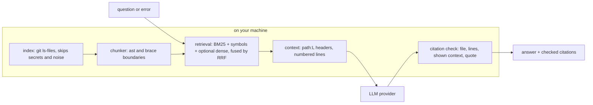

# VIBETTER

**Questions about AI-written code, answered from your repo, with every file:line citation checked.**

VIBETTER is an MCP server for Claude Code, Cursor, Claude Desktop and Windsurf. It splits your
repo into line-numbered chunks, retrieves the ones a question needs, and asks the model you
choose to cite `path:L12-L20`. Then it checks each citation without a second model call: the
file must be indexed, the lines must exist, and the lines must be in the context the model was
shown. It also explains the latest change, diagnoses errors, and draws a dependency graph from
static imports.

[](https://github.com/neerajbhargav/vibetter/actions/workflows/ci.yml)
[](LICENSE)
[](https://www.python.org/downloads/)

## The problem

AI coding tools ship code faster than you can read it. You accept a diff, the tests pass, and
six weeks later nobody on the team can explain why that file exists.

VIBETTER runs inside the same IDE session, reads the same repo, and gives the model the source
itself rather than a summary. Ask it what changed and why, then check the cited lines.

---

## Install

### Mac and Linux
```bash
curl -fsSL https://raw.githubusercontent.com/neerajbhargav/vibetter/main/install.sh | bash
```

### Windows (PowerShell)
```powershell
iwr -useb https://raw.githubusercontent.com/neerajbhargav/vibetter/main/install.ps1 | iex
```

The installer:
1. Clones VIBETTER to `~/.vibetter` and installs it into its own virtualenv (`~/.vibetter/venv`).
2. Asks for a provider (Gemini, OpenAI, Anthropic or local Ollama) and, for a cloud provider,
   the API key. Input is hidden.
3. Stores the key once, in `~/.vibetter/.env` (mode 600 on Mac and Linux). IDE configs get only
   the `vibetter` command, never the key.
4. Registers the server with Claude Code (`claude mcp add`), Cursor, Claude Desktop and Windsurf
   when it finds them. It backs up each JSON config first. A config it cannot parse (for example
   one with comments) is left unchanged, and the installer prints the manual step instead.

For a non-interactive install, set `VIBETTER_PROVIDER` and the key variable first, for example
`VIBETTER_PROVIDER=ollama`, or `VIBETTER_PROVIDER=openai OPENAI_API_KEY=...`.

### With uv
```bash
uvx --from "vibetter[openai] @ git+https://github.com/neerajbhargav/vibetter" vibetter --version
```
Put the provider settings in `~/.vibetter/.env` (see `.env.example`). In the IDE config, the
command is `uvx` with the arguments `--from`, `vibetter[openai] @ git+https://github.com/neerajbhargav/vibetter`
and `vibetter`.

---

## Supported providers

| Provider | API key | Default model chain (tried in order) |
|----------|---------|--------------------------------------|
| Google Gemini | Yes ([get key](https://aistudio.google.com/apikey)) | gemini-3.5-flash-lite, gemini-3.8-flash, gemini-3.6-flash |
| OpenAI | Yes ([get key](https://platform.openai.com/api-keys)) | gpt-6-luna, gpt-6.1-sol |
| Anthropic Claude | Yes ([get key](https://console.anthropic.com/settings/keys)) | claude-haiku-5-5, claude-sonnet-5-5 |
| Ollama (local) | No | qwen2.5-coder:7b (`ollama pull qwen2.5-coder:7b` first) |

Model IDs were checked against each provider's model list on 2026-10-21. Set `VIBETTER_MODEL`
in `~/.vibetter/.env` to try another model first. A rate limit, server error, connection error
or missing model moves to the next model in the chain; an authentication or request error stops
at once and comes back to the IDE as a tool error.

---

## Tools

The question tools return structured output: the answer, a checked list of its citations, and
retrieval stats. `strict=true` (or `VIBETTER_STRICT=1`) removes each sentence whose citation
fails and says what it removed.

### `explain_last_change(strict?)`
Explains the latest change: staged and unstaged edits plus new untracked files (what an AI agent
usually creates). On a clean tree it explains the last commit, including a repo's first commit.
Secret files and lockfiles are left out of the diff. Each diff line carries its new-file line
number, and citations are checked against the hunks that were shown.

### `scholar_explain(file_path, question, strict?)`
Answers a question about one file. The context holds that file first, then the chunks of the
rest of the repo that rank best for the question, within a 24,000-character budget. A path that
is not in the index returns an error with the closest matches.
```
scholar_explain("src/auth.js", "Why is the token stored in httpOnly cookies instead of localStorage?")
```

### `debug_error_in_context(error_message, file_path?, strict?)`
Paste an error message. Traceback frames such as `File "app/db.py", line 41` pull those exact
chunks into the context. The model returns the cause and a concrete fix, with checked citations.
```
debug_error_in_context("TypeError: Cannot read properties of undefined (reading 'map')")
```

### `search_code(query, limit?, file_path?)`
Retrieval only, no LLM call and no key. Returns the best chunks with `path:Lstart-Lend` headers
and numbered lines, so a host agent can read and cite them.

### `verify_citations(text, strict?)`
No LLM call. Checks every `path:line` reference in a text against the index: the file exists,
the lines exist, and a code quote placed right after the citation matches those lines. Host
agents can run it on their own answers.

### `generate_blueprint(labels?)`
Builds the file dependency graph from static imports: Python `ast`, plus `import`, `export
... from`, `require()` and `import()` in JS, TS and Vue. The layout is deterministic, so the
same files give the same graph. `labels=true` asks the model to name groups of files; the
edges never come from the model. MCP Apps hosts render `ui://blueprint` inline; other hosts can
open the resource.

### `generate_audio_overview(question, file_path?)`
Writes a spoken MP3 walkthrough to `~/.vibetter/outputs`. It uses gTTS, which sends the
transcript to Google's text-to-speech service.

### Try it without a key
`search_code` and `verify_citations` need no provider, and both have terminal commands. The
test fixture is a small synthetic bookshop:
```bash
git clone https://github.com/neerajbhargav/vibetter && cd vibetter/tests/fixtures/shop
uv run vibetter search "how is a discount code applied" --limit 1
printf 'Big discounts raise at shop/cart.py:L24-L25 `raise ValueError`.\nCoupons expire in shop/coupons.py:L12.\n' | uv run vibetter verify
```
The second command prints:
```
citations: 2 found, 1 valid
  ok shop/cart.py:L24-L25
  !! shop/coupons.py:L12  (file not indexed)
```
and exits with status 2 because one citation failed.

---

## How it works



- **Index.** In a git repo the file list comes from `git ls-files -co --exclude-standard`, so
  `.gitignore` applies. Outside git, a walk honors each directory's `.gitignore`. Lockfiles,
  minified bundles, binaries, files over 1 MB and secret files are skipped; `vibetter index
  --stats` shows what was skipped and why.
- **Chunks.** About 60 lines each, at most 120. Python chunks end at top-level definitions
  found with `ast`; other files end at blank lines outside braces. Only a forced cut, where no
  boundary exists, repeats 5 lines.
- **Retrieval.** Three ranked lists are fused by reciprocal rank fusion: BM25 over a tokenizer
  that splits camelCase, snake_case and path segments while keeping whole identifiers; a
  symbol index (definitions, file names, traceback frames); and, with `pip install
  'vibetter[dense]'`, fastembed embeddings from `BAAI/bge-small-en-v1.5`. The model downloads
  to `~/.vibetter/models` on first use; `VIBETTER_DENSE=0` turns the arm off.
- **Citation check.** A citation is valid when the file is indexed and the lines exist, and
  grounded when the lines overlap the context the model was shown. The parser accepts
  `path:L12-L20`, `path:12-20`, `path#L12`, `path L12-L20`, `path, lines 12-20` and traceback
  frames. The prompt's example citation uses placeholders (`path:L<first>-L<last>`), not
  numbers: a model can copy an example word for word, and a copied range of real lines would
  pass the check.
- **Freshness.** A file watcher waits until saves stop for 0.3 s (at most 5 s), then re-reads
  only the files that changed. The retriever re-chunks only those files.
- **Startup.** The index is built on the first tool call (or in a background thread when the
  server starts), not at import, so the MCP handshake does not wait for it.
- **Codebase root.** `VIBETTER_CODEBASE_PATH`, else the directory the IDE starts the server in.
  If that is `/` or your home directory, VIBETTER refuses to index it and tells you to set
  `VIBETTER_CODEBASE_PATH` in the server config.
- **Ollama.** The request sets `num_ctx` to fit the prompt (8k to 32k tokens). Without it,
  Ollama keeps its small default window and drops the start of a long prompt without an error.
  `VIBETTER_OLLAMA_NUM_CTX` overrides it.
- **Traces.** Each tool call appends one JSON line to `~/.vibetter/traces.jsonl`: tool,
  provider, model, latency, prompt size, chunks retrieved and citation counts.
  `VIBETTER_TRACE=0` turns it off. With `pip install 'vibetter[otel]'` and `VIBETTER_OTEL=1`,
  each call is also exported as an OpenTelemetry span over OTLP.
- **Errors.** Provider and lookup failures are MCP tool errors (`isError`), not answer text.

## Limitations

- The check proves that a citation points at real lines the model saw. It does not prove that
  the sentence around it is true. A claim with no citation is not checked; strict mode only
  flags an answer that has no citations at all.
- JS, TS and Vue imports come from a regex, not a parser. Imports built at runtime, path
  aliases other than `@/` and `~/`, and other languages are not in the graph. Graphs over 150
  files keep the 150 best connected.
- Retrieval quality has not been measured yet. An eval is the next step; until then, no
  accuracy number is claimed.

## What leaves your machine

The prompt goes to the provider you chose: the prompt template, your question or error
message, and the line-numbered context or diff. With Ollama on localhost, nothing leaves. Before sending, VIBETTER
skips `.env*`, `*.pem`, `*.key`, `*credentials*.json`, `id_rsa*` and similar files, and
redacts AWS key ids, GitHub tokens, OpenAI, Anthropic and Google keys, JWTs, private key blocks
and `api_key`/`secret`/`token`/`password` assignments in the remaining text. Redaction is
pattern-based, so treat it as a safety net, not a guarantee. `search_code` hits are redacted
the same way, because the host agent sends them to its own model. Repo text goes into the prompt as
data; a file that contains instructions can still steer the model's answer.

---

## Requirements

- Python 3.10 or newer, and git
- An API key for your chosen provider, or Ollama installed locally
- An MCP client: Claude Code, Cursor, Claude Desktop, Windsurf, or any other MCP host

## Manual setup

```bash
git clone https://github.com/neerajbhargav/vibetter.git ~/.vibetter
python3 -m venv ~/.vibetter/venv
~/.vibetter/venv/bin/pip install -e "$HOME/.vibetter[openai]"   # or gemini, anthropic, ollama
printf 'VIBETTER_PROVIDER=openai\nOPENAI_API_KEY=your_key_here\n' > ~/.vibetter/.env
chmod 600 ~/.vibetter/.env
claude mcp add vibetter -s user -- ~/.vibetter/venv/bin/vibetter
```

For Cursor, Claude Desktop or Windsurf, add this to the IDE's MCP JSON config, with the full
path to the command:
```json
{
  "mcpServers": {
    "vibetter": {
      "command": "/Users/you/.vibetter/venv/bin/vibetter"
    }
  }
}
```

From a terminal:
```bash
vibetter ask "What does divide() do?" --file src/calc.py   # prints checked citations
vibetter search "where are tokens refreshed"               # no LLM call
vibetter verify answer.md                                  # exit 2 if a citation fails
vibetter index --stats
```

## Development

```bash
uv sync                      # Python 3.10+, dev tools, all provider SDKs, OpenTelemetry SDK
uv run pytest                # offline: fake LLM, in-memory MCP client, no keys
uv run ruff check . && uv run ruff format --check . && uv run pyright
cd frontend && npm ci && npm run build   # rebuilds src/vibetter/ui
```

CI runs ruff and pyright, pytest on Python 3.10 to 3.13, the frontend build (which must
reproduce the committed `src/vibetter/ui`), and syntax checks for both installers.

Repo map: `src/vibetter/` is the package: `server.py` (tools), `index.py` (file index and
watcher), `chunk.py` (line-aware chunks), `retrieve.py` (BM25, symbols, dense arm, RRF and
context assembly), `cite.py` (citation parser and checker), `graph.py` (static import graph
and layout), `gitdiff.py` (change collection), `providers.py` (LLM providers), `trace.py`
(JSONL and OpenTelemetry traces), `redact.py` (secret handling), `ide.py` (IDE config
registration) and `cli.py` (the `vibetter` command). `frontend/` is the Vue Flow blueprint UI.
`tests/` holds the offline suite, and `tests/fixtures/shop` is a synthetic Python and Vue repo
the tests run against.

---

## License

MIT. See [LICENSE](LICENSE).

## Author

Built by [Neeraj Bhargav Rondla](https://neerajbhargav.com), applied AI engineer.
More MCP and agent tooling: [context-refinery](https://github.com/neerajbhargav/context-refinery).
