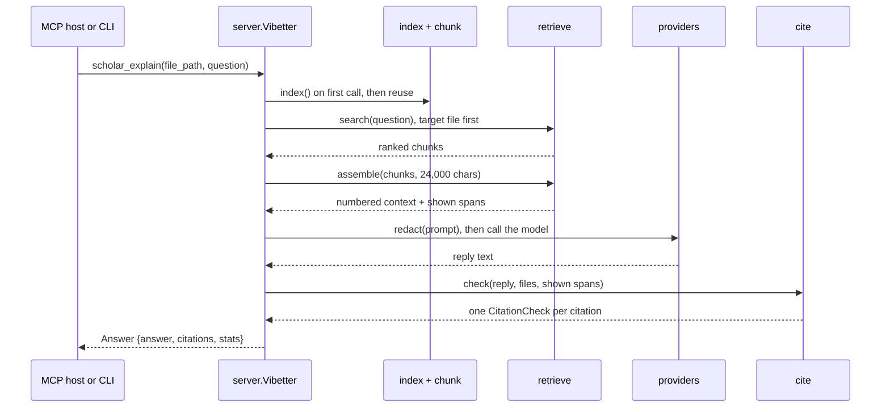

# Architecture

VIBETTER answers questions about a repo and checks every `path:line` citation it parses in the
answer.
This page describes the modules, how data moves through them, and the exact contract the
citation verifier enforces. The code lives in `src/vibetter/`; each module's docstring repeats
the part of this page that concerns it.

## Modules

| Module | Job |
|---|---|
| `server.py` | The seven MCP tools and the `ui://blueprint` resource. `Vibetter` holds the tool logic that the MCP server and the CLI share. |
| `cli.py` | The `vibetter` command: `serve` (default), `ask`, `search`, `verify`, `index`. |
| `config.py` | `~/.vibetter` paths, `.env` loading, and the choice of codebase root. |
| `index.py` | `CodebaseIndex`: which files are read, why others are skipped, and the file watcher. |
| `chunk.py` | Splits each file into line-aware chunks. |
| `retrieve.py` | BM25, the symbol and path index, the optional dense arm, RRF fusion, and context assembly. |
| `prompts.py` | Prompt templates and the citation rule. |
| `providers.py` | Gemini, OpenAI, Anthropic and Ollama calls, model chains, error classes. |
| `cite.py` | The citation parser and checker, and strict mode. |
| `gitdiff.py` | Collects the latest change for `explain_last_change` and numbers its lines. |
| `graph.py` | The import graph from static analysis, with a deterministic layout. |
| `redact.py` | Secret files that are never read, and redaction of outgoing text. |
| `trace.py` | One JSONL line per tool call, plus optional OpenTelemetry spans. |
| `ide.py` | Writes the server entry into an IDE's JSON MCP config (used by the installers). |
| `ui/` | The built Vue Flow blueprint view, generated from `frontend/` by `npm run build`. |

## Data flow for a question

1. **Root.** `resolve_root` takes the `--root` argument, else `VIBETTER_CODEBASE_PATH`, else the
   working directory. It refuses `/` and the home directory when they come from the working
   directory, because some hosts start servers there.
2. **Index.** In a git repo the file list is `git ls-files -co --exclude-standard`, so
   `.gitignore` applies as git applies it. Outside git, or inside a parent repo that ignores
   the whole folder, a walk honors each directory's `.gitignore`. Lockfiles, minified bundles, binaries, files over 1 MB and secret files are
   skipped, each with a reason that `vibetter index --stats` prints. The index is built on the
   first tool call, not at import. With the watcher on, created, modified, deleted and moved
   events feed a trailing-edge debounce (0.3 s, at most 5 s); a flush re-reads only the changed
   files and bumps `version`.
3. **Chunks.** A chunk is a span of whole lines, 1-based and inclusive, aiming for 60 lines and
   never over 120. Python chunks end at top-level `def` or `class` lines found with `ast`.
   Other files end at a blank line outside braces. Only a forced cut, where no boundary
   exists, repeats 5 lines.
4. **Retrieval.** Three ranked lists are fused by reciprocal rank fusion (RRF, k = 60):
   - BM25 over a tokenizer that splits camelCase, snake_case and path segments and also keeps
     each whole identifier.
   - A symbol and path index: definitions (from `ast` for Python, regexes for JS, TS and Vue),
     file names, and `file:line` references such as traceback frames. A chunk at a `file:line`
     the query names is put first, ahead of the fused ranking. Only identifiers written as code
     match it: snake_case, camelCase, dotted names, calls, keyword arguments and
     backticked names. Plain English words go to BM25 only. Before this rule, "redirect" in a
     question pulled every `test_redirect_*` function into the ranking (see
     [eval/README.md](../eval/README.md)).
   - Optionally, dense embeddings (`pip install 'vibetter[dense]'`, fastembed with
     `BAAI/bge-small-en-v1.5`). It is off unless `VIBETTER_DENSE=1`, because it lowered
     recall in the eval.
5. **Context.** `assemble` packs chunks in rank order into a character budget: the target file
   first, then the best chunks from the rest of the repo, then the first chunk of every file as
   a fallback for broad questions. A chunk that does not fit is skipped and packing continues.
   Each block has a `--- path:Lstart-Lend ---` header and `  NN| ` line prefixes. The function
   also returns the shown spans: for each file, the merged line ranges the model will see.
6. **Model.** `ask_llm` is the one exit point for text that leaves the machine. It runs
   `redact()` on the whole prompt first. The prompt states the citation rule before the
   context and again after it, because small local models drop instructions that come before
   a long context. Its examples use placeholders (`path:L<first>-L<last>`), because
   qwen2.5-coder:7b copied a numeric example word for word, and a copied range of real lines
   passes the check. For Ollama, the request sets `num_ctx` to the smallest of 8k, 16k or
   32k tokens that fits the prompt; without it, Ollama silently drops the start of a long
   prompt. Fixed sizes matter because Ollama reloads the model whenever `num_ctx` changes.
7. **Verification.** `cite.check` parses every citation in the reply and checks it against the
   indexed files and the shown spans. No model is involved. The result is an `Answer`: the
   reply text (or the strict-mode text), one `CitationCheck` per distinct cited span, and the
   trace fields for this call as `stats`.

`explain_last_change` follows the same path with a diff in place of retrieved chunks.
`gitdiff.collect_changes` takes staged, unstaged and untracked changes, or the last commit on a
clean tree (a merge commit against its first parent), leaves out secret files and lockfiles,
and budgets each file so one large file does not crowd out the rest. It pins the `a/` and `b/`
prefixes, reads paths unquoted and skips textconv drivers, so the user's git config cannot
change the paths. A change with no line edits is an error, not an empty prompt. Each line
inside a hunk carries its new-file line number, and `shown_spans` gives the new-file lines the
diff shows, for the grounding check. The diffed files are re-read before the check, because
the watcher's index can lag behind git by the debounce.

`search_code` and `verify_citations` stop before the model step. `search_code` redacts each hit,
because the host agent sends the hits to its own model. `verify_citations` checks a text that
the caller wrote, so it has no shown spans and no grounding verdict.

`generate_blueprint` never asks the model for structure. `graph.py` reads Python imports with
`ast` and JS, TS and Vue imports with a regex over `import`, `export ... from`, `require()` and
`import()`. The layout breaks cycles by a DFS in path order and sets layers by the longest path
from entry files, so the same files always give the same graph. `labels=true` asks the model
only to name groups of files.

## The verifier contract

`cite.parse` finds citations in free text. It accepts the form the prompt asks for,
`path:L12-L20` or `path:L12`, and the variants models write anyway: `path:12-20`,
`path#L12-L20`, `path L12-L20`, `path:12:5`, `path, lines 12-20`, `path (line 12)`,
`path at line 12`, `(path:path/x.py:L12)`, `lines 12-20 of path` and
`File "path", line 12`. Line numbers are ASCII digits. A path starts only at a token boundary
(the start of the text, whitespace, a quote or backtick, `(`, `[` and similar), may start with
a dot (`.github/workflows/ci.yml`) and may hold `[slug]` and `(group)` segments. So it skips
URLs such as `https://host/x.py:12` and `host:port` forms, and it never starts inside a word:
`app/shop/[id]/page.tsx` is not read as `/page.tsx`. No two repeats in the pattern can trade
characters, so parsing time is linear in the text. A code quote in backticks or double quotes
placed right after a citation, or right after the bracket that closes it, is attached to that
citation, unless the quote is itself a citation or has fewer than 3 non-space characters.

`cite.check_ref` then gives each citation these verdicts:

| Field | True when | Values |
|---|---|---|
| `valid` | the path resolves to one indexed file, and `1 <= start <= end <= line count` | always set |
| `grounded` | every cited line lies in one span of that file the model was shown | `None` when no shown spans were passed (`verify_citations`) |
| `quote_match` | every part of the quote (split on `...`) appears in the cited lines, whitespace squashed | `None` when no quote follows the citation |
| `verified` | `valid`, and neither `grounded` nor `quote_match` is `False` | derived |

Path resolution accepts `./x`, absolute paths under the root, backslashes, and a shorter path
that matches exactly one indexed file by suffix. It never accepts an invented relative prefix:
`source/utils/types/retry.ts` does not resolve to `source/types/retry.ts`. An absolute path
outside the root is accepted when it ends in exactly one indexed path, so a traceback from
another checkout (`/srv/app/shop/cart.py`) resolves to `shop/cart.py`. The verifier only
looks up indexed text; it never reads a file outside the index.

Each failed check carries one `reason`: `file not indexed`, `ambiguous path: N indexed files
match`, `malformed line range`, `line out of range: the file has N lines`, `lines exist but
were not in the context shown to the model`, `only part of the range was in the context shown
to the model`, or `quoted code does not appear in the cited lines`.

`cite.unique` keeps one check per `(path, start, end)` and keeps the worst verdict when a span
is cited twice. `cite.counts` reports `total`, `valid`, `grounded` and `unverified`.

**Strict mode** (`strict=true`, `--strict` or `VIBETTER_STRICT=1`) removes each sentence that
contains a citation that did not verify and appends a note naming the removed citations and
why. An answer with no citations at all gets a note that there was nothing to verify.

**What the contract does not cover.** It proves that a citation points at real lines, and at
lines the model saw. It does not prove that the sentence around the citation is true. A claim
with no citation is not checked. A bare range with no path, such as "and L43-L46" after a
citation, is not parsed, nor is a file named only in prose. A file name with spaces is read
from its last word.

## Errors and traces

Provider failures, unknown paths and refused roots raise `VibetterError`, which the MCP layer
turns into a tool error (`isError`), never into answer text. A rate limit, server error,
connection error or missing model moves to the next model in the provider's chain; an
authentication or request error stops at once. Errors are classified by SDK exception type and
HTTP status, not by matching words in the message.

Every tool call appends one JSON line to `~/.vibetter/traces.jsonl`: tool, provider, model,
latency, prompt size, chunks retrieved and in context, and citation counts. `VIBETTER_TRACE=0`
turns it off. With the `otel` extra and `VIBETTER_OTEL=1`, each call is also an OpenTelemetry
span exported over OTLP.

## Tests and evals

`tests/` runs offline: a fake LLM is injected through `create_server(root, llm)`, and the MCP
tools are driven through the in-memory FastMCP client against `tests/fixtures/shop`, a small
synthetic bookshop in Python and Vue. `eval/` holds the public eval: 66 questions with gold
line spans over three pinned public repos, a deterministic retrieval eval that CI runs as a
gate, and a model-backed answer eval that runs locally on Ollama. See
[eval/README.md](../eval/README.md).
